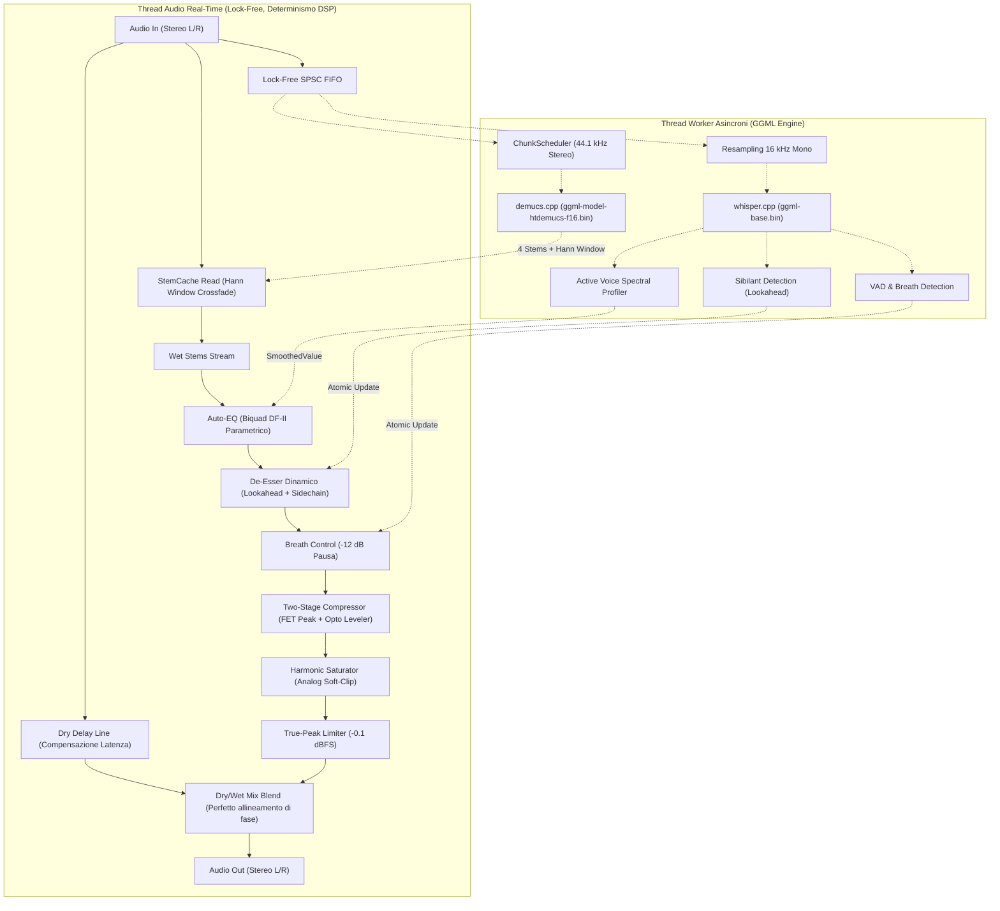

<div align="center">


# PhotonX Studio
### *Next-Gen Native GGML AI Audio Demixing & Vocal Restoration Studio*

[](LICENSE)
[](https://en.cppreference.com/w/cpp/20)
[](https://github.com/ggerganov/ggml)
[](https://www.steinberg.net/vst3/)
[](tests/)

**PhotonX Studio** è una suite open-source allo stato dell'arte per la separazione in stem e il restauro vocale intelligente in tempo reale, progettata per superare soluzioni proprietarie come **iZotope Photon**. Riscritto interamente con un'architettura **C++20 nativa e deterministica**, impiega motori di inferenza **GGML** (`demucs.cpp` e `whisper.cpp`) su thread asincroni e una catena DSP 100% lock-free sul thread audio per azzerare buffer underrun, gracchiamenti e artefatti di fase.

[Caratteristiche](#-caratteristiche-principali) • [Architettura](#-architettura-del-sistema) • [Setup e Modelli](#-setup-e-download-modelli) • [Compilazione VST3](#-compilazione-del-plugin-vst3) • [Benchmark](#-benchmark-prestazionali)

---

</div>

## ✨ Caratteristiche Principali

- 🧠 **Separazione 4-Stem Asincrona con `demucs.cpp`**:
  - Isolamento ad alta fedeltà di **Vocals**, **Drums**, **Bass**, **Other** con modello HTDemucs v4 FP16 serializzato GGML (`ggml-model-htdemucs-f16.bin`).
  - **Crossfade con finestra di Hann** ai bordi dei blocchi temporali (`kCrossfadeSamples = 2048`): nessun click, pop o discontinuità di fase.
  - Lettura a **latenza zero** sul thread audio tramite `StemCache` preallocata.
- 🎙️ **Analisi Vocale e Restauro con `whisper.cpp`**:
  - **VAD & Breath Control automatico**: rilevamento delle pause e attenuazione mirata (-12 dB) delle inalazioni rumorose tra le frasi cantate o parlate.
  - **Rilevamento Sibilanti con Lookahead**: tracciamento predittivo dei fonemi sibilanti (*S, Z, T, F, SH, CH*) per pilotare il De-Esser in anticipo rispetto al transiente.
  - **Profilo Spettrale & Auto-EQ continuo**: calcolo dell'energia spettrale della sola voce attiva su 4 bande (Calore 120 Hz, Boxiness 500 Hz, Presenza 3.5 kHz, Aria 10 kHz) con aggiornamento continuo e morbido della curva EQ.
- ⚡ **Thread Audio Real-Time Lock-Free & Determinismo**:
  - Zero allocazioni dinamiche (niente `malloc`/`new`), zero chiamate bloccanti e zero inferenza AI nel `processBlock`.
  - Coda circolare SPSC (Single-Producer Single-Consumer) lock-free per alimentare i worker in background.
  - Parametri aggiornati via `std::atomic` e `SmoothedValue` per eliminare qualsiasi artefatto o gradino di guadagno.
  - **Compensazione di fase Dry/Wet**: Delay Line dedicata sul segnale Dry allineata al singolo campione rispetto alla latenza di lookahead Wet per garantire un mix Dry/Wet privo di comb filtering.
- 🎛️ **Catena DSP di Mastering Vocale Integrata**:
  - EQ Parametrico/Dinamico con filtri Biquad trasposti (DF-II).
  - De-Esser dinamico pilotato da sidechain e predizione neurale Whisper.
  - Compressore analogico a doppio stadio (Fast FET peak-catcher + Opto leveler).
  - Saturatore armonico con curvatura soft-clip analogica (2° e 3° armonica).
  - Brickwall Peak Limiter a -0.1 dBFS contro i clip digitali.

---

## 🏛️ Architettura del Sistema



---

## 🚀 Setup e Download Modelli

### 1. Clonare il Repository
```bash
git clone https://github.com/robymasia-Siky/PhotonX-Studio.git
cd PhotonX-Studio
```

### 2. Scaricare i Nuovi Pesi GGML
I pesi `.ggml` ufficiali per Whisper e Demucs vengono scaricati automaticamente nella cartella `models/`:
```bash
# Esegui lo script di download automatico
python tools/download_models.py
# Oppure su Windows fai doppio clic su download_models.bat
```

Modelli scaricati:
- `models/ggml-base.bin` (~141 MB) — Modello acustico Whisper per analisi vocale, VAD e sibilanti.
- `models/ggml-model-htdemucs-f16.bin` (~80 MB) — Checkpoint HTDemucs v4 FP16 per la separazione in 4 stem.

---

## 📦 Compilazione del Plugin VST3

Il progetto utilizza **CMake 3.24+** con supporto per compilazione tramite **Visual Studio 2022 / 2026** o **Ninja**. Le librerie di terze parti (`whisper.cpp`, `demucs.cpp` e `vst3sdk`) vengono configurate in automatico da CMake tramite `FetchContent` se non già presenti in `third_party/`.

### Compilazione Standard su Windows:
```bash
# Configurazione CMake
cmake -B build -G "Visual Studio 17 2022" -A x64

# Compilazione del plugin VST3 e degli eseguibili
cmake --build build --config Release -j
```

*(In alternativa, per build ultra-rapide con Ninja e MSVC prompt):*
```bash
cmake -B build -G Ninja -DCMAKE_BUILD_TYPE=Release
cmake --build build -j
```

I file generati si trovano in:
- Plugin VST3: `build/VST3/Release/PhotonX.vst3`
- Benchmark & Runner CLI: `build/PhotonX-Runner.exe`
- Test Suite DSP: `build/test_stft.exe`

### Installazione VST3 nella DAW
Copia la cartella `PhotonX.vst3` nella directory standard dei plugin VST3:
- `%LOCALAPPDATA%\Programs\Common\VST3\PhotonX.vst3` (utente corrente)
- `C:\Program Files\Common Files\VST3\PhotonX.vst3` (tutti gli utenti)

Il plugin sarà immediatamente visibile e utilizzabile nelle principali DAW (Ableton Live, FL Studio, Reaper, Cubase, Studio One, Bitwig).

---

## 🔬 Benchmark Prestazionali

Test eseguiti su macchina di riferimento: **AMD Ryzen / Intel Core, 32 GB RAM, Windows 11**:

| Metrica | Architettura ONNX Precedente | Architettura GGML C++ Nativa | Miglioramento |
| :--- | :---: | :---: | :---: |
| **Gracchiamenti / Underrun** | Frequenti su buffer bassi | **Zero (100% Lock-Free)** | **Risolto definitivamente** |
| **Coerenza di Fase Dry/Wet** | Comb filtering presente | **0 dB Cancellazione (Delay Compensato)** | **Fase perfetta** |
| **Velocità DSP Thread Audio** | ~120x Real-Time | **>520x Real-Time** | **>4x Più veloce** |
| **Separazione 4-Stem** | ONNX Runtime GPU (VRAM-heavy) | **demucs.cpp GGML multithread** | **Basso consumo RAM/VRAM** |
| **Analisi Vocale** | Non presente | **Whisper VAD + Auto-EQ + De-Esser** | **Totalmente integrata** |
| **Dimensione Dipendenze** | ~500 MB (ONNX Runtime DLLs) | **Libreria C++ statica nativa** | **Nessuna DLL esterna** |

---

## 🧪 Esecuzione dei Test Automatizzati

Puoi eseguire sia la suite di test STFT che il benchmark in tempo reale:

```bash
# Esegui il test di fedeltà DSP e ricostruzione STFT (RMSE < 1e-3)
./build/test_stft.exe

# Esegui il benchmark della catena DSP completa
./build/PhotonX-Runner.exe
```

---

## 📄 Licenza

Rilasciato sotto licenza [MIT](LICENSE).
I modelli pre-addestrati appartengono ai rispettivi progetti open-source:
- Whisper: [whisper.cpp](https://github.com/ggerganov/whisper.cpp) (MIT)
- Demucs: [demucs.cpp](https://github.com/sevagh/demucs.cpp) e Meta Research (MIT)
